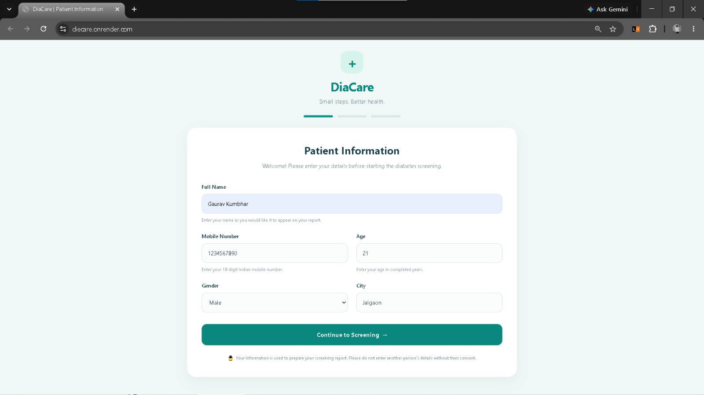
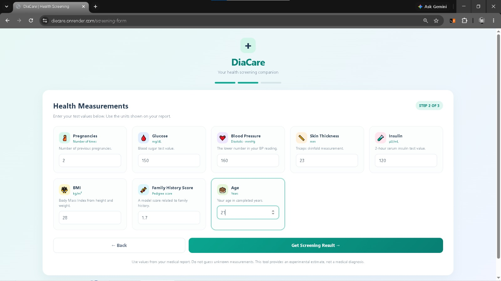
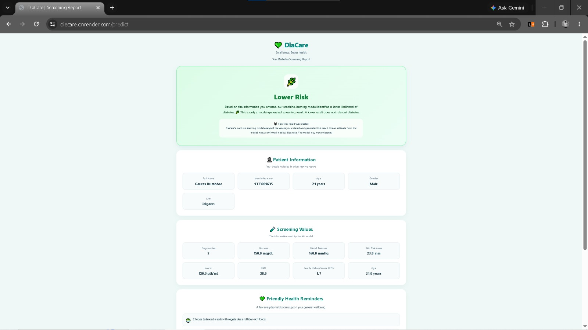

# 🩺 DiaCare – Diabetes Risk Screening & Prediction Web Applic

### An Educational Machine Learning Project Using Python, Flask and Scikit-learn


---

## 📌 Project Overview

**DiaCare** is a Flask-based web application that demonstrates how machine learning can be integrated into a diabetes-risk screening workflow.

Users enter basic patient information and eight health-related measurements. The application processes the submitted values using a saved `StandardScaler` and trained classification model, then displays an estimated screening result in a report-style interface.

The project demonstrates practical implementation of machine learning, data preprocessing, Flask web development, HTML, CSS and application deployment.

> **Medical Disclaimer:** DiaCare is an educational portfolio project, not a clinically validated medical tool. Its predictions must not be used to diagnose diabetes, make treatment decisions or replace advice from qualified healthcare professionals.

## ✨ Key Features

- **Patient Information:** Collects basic patient details before screening.
- **Health Measurements:** Accepts eight health-related input features.
- **Machine Learning Integration:** Uses a trained classification model for prediction.
- **Data Preprocessing:** Applies a saved StandardScaler before model prediction.
- **Screening Report:** Displays the screening result and submitted information.
- **Print / Save as PDF:** Allows users to print or save the report through the browser.
- **New Screening:** Allows users to start another screening session.
- **Responsive Interface:** Designed to adapt to desktop, tablet and mobile screens.
- **Web Deployment:** Configured for hosting on Render.

## 🖥️ Application Screenshots

### 1. Patient Information Page

The first page collects basic patient information before starting the screening process.



### 2. Health Measurements Page

The second page collects eight health-related measurements required by the machine learning model.



### 3. Screening Result Page

The third page displays the estimated screening result, patient information and submitted health measurements. Users can also print or save the report as a PDF.



## 🧠 Dataset Information

This project uses the **Pima Indians Diabetes Dataset**.

| Dataset Detail | Information |
|---|---|
| Total Records | 768 |
| Input Features | 8 |
| Target Variable | Outcome |
| Classification Type | Binary Classification |

### Input Features

| Feature | Description |
|---|---|
| Pregnancies | Number of pregnancies |
| Glucose | Plasma glucose concentration |
| BloodPressure | Diastolic blood pressure |
| SkinThickness | Triceps skinfold thickness |
| Insulin | 2-hour serum insulin |
| BMI | Body Mass Index |
| DiabetesPedigreeFunction | Diabetes pedigree function |
| Age | Age in years |

**Dataset Limitation:** The Pima Indians Diabetes Dataset represents a specific population of women. It is not representative of everyone, and its predictions should not be generalized to all populations.

## ⚙️ Technology Stack

| Technology | Purpose |
|---|---|
| Python | Application development and model integration |
| Flask | Backend web framework and routing |
| Pandas | Data handling and manipulation |
| NumPy | Numerical operations |
| Scikit-learn | Machine learning and preprocessing |
| StandardScaler | Feature scaling |
| HTML5 | Web page structure |
| CSS3 | Responsive user interface |
| Pickle | Loading saved model and scaler artifacts |
| Git & GitHub | Version control and project hosting |
| Render | Web application hosting |

## 🔄 Application Workflow

```text
        Patient Information
                 |
                 v
        Health Measurements
                 |
                 v
        Input Data Collection
                 |
                 v
        StandardScaler
                 |
                 v
     Trained Classification Model
                 |
                 v
         Screening Result
                 |
                 v
       Result Report Display
                 |
          +------+------+
          |             |
          v             v
       Print       Save as PDF
```

## 📁 Project Structure

```text
DieCare/
│
├── Dataset/
│   └── diabetes.csv
│
├── Images/
│   ├── patientinfo.jpeg
│   ├── Measurement.jpeg
│   └── Result.jpeg
│
├── Model/
│   ├── modelForPrediction.pkl
│   └── standardScalar.pkl
│
├── Notebook/
│
├── templates/
│   ├── index.html
│   ├── home.html
│   └── single_prediction.html
│
├── application.py
├── requirements.txt
├── README.md
├── .gitignore
└── data.json
```

*The structure above reflects the project files shown in the repository Explorer. Keep the listed files and folders synchronized with your actual GitHub repository.*

## 🚀 Installation and Setup

Follow these steps to run DiaCare locally.

### 1. Clone the Repository

```bash
git clone https://github.com/GAURAV24-CODE/DieCare.git
```

### 2. Open the Project Folder

```bash
cd DieCare
```

### 3. Create a Virtual Environment

```bash
python -m venv .venv
```

### 4. Activate the Virtual Environment

**Windows PowerShell:**

```powershell
.venv\Scripts\Activate.ps1
```

**Windows Command Prompt:**

```cmd
.venv\Scripts\activate
```

**macOS / Linux:**

```bash
source .venv/bin/activate
```

### 5. Install Required Dependencies

```bash
pip install -r requirements.txt
```

### 6. Run the Application

```bash
python application.py
```

### 7. Open in Your Browser

Visit:

```text
http://127.0.0.1:5000/
```

The DiaCare application should now be accessible locally.

## ☁️ Deployment

The application is configured for deployment on **Render** using Gunicorn.

**Render configuration:**

| Setting | Value |
|---|---|
| Environment | Python 3 |
| Build Command | `pip install -r requirements.txt` |
| Start Command | `gunicorn application:app` |
| Root Directory | Leave blank if the application is in the repository root |

### Environment Variable

Configure a secret key in the Render dashboard:

```text
SECRET_KEY=your_generated_secret_key
```

Keep secret values private. Do not commit them to GitHub.

**Live Demo:** Add your verified public Render URL here once you have confirmed that the application loads successfully.

## 🔮 Future Improvements

- Add model evaluation metrics such as accuracy, precision, recall and F1-score.
- Generate a confusion matrix to evaluate classification performance.
- Perform additional exploratory data analysis (EDA).
- Compare multiple machine learning classification algorithms.
- Add data visualization using Matplotlib and Seaborn.
- Develop a Power BI dashboard for dataset-level analysis.
- Improve application validation, accessibility and privacy protections.

## 🎯 Learning Outcomes

Through this project, I practiced:

- Integrating a machine learning model into a Flask application.
- Applying feature scaling during prediction.
- Handling user input through HTML forms.
- Connecting frontend pages with backend Flask routes.
- Displaying prediction results dynamically.
- Creating responsive web interfaces using HTML and CSS.
- Preparing a Python application for deployment.

## 👨‍💻 Author

**Gaurav Kumbhar**

MCA Student | Aspiring Data Scientist | Machine Learning Enthusiast

- **GitHub:** [GAURAV24-CODE](https://github.com/GAURAV24-CODE)
- **LinkedIn:** [Gaurav Kumbhar](https://www.linkedin.com/in/gaurav-kumbhar-0b4a39293/)
- **Project Repository:** [DiaCare – GitHub](https://github.com/GAURAV24-CODE/DieCare)

---

### ⭐ If you find this project useful, consider giving the repository a star!

*Built as a learning project to practice Python, machine learning integration, Flask development, responsive web design and deployment.*
